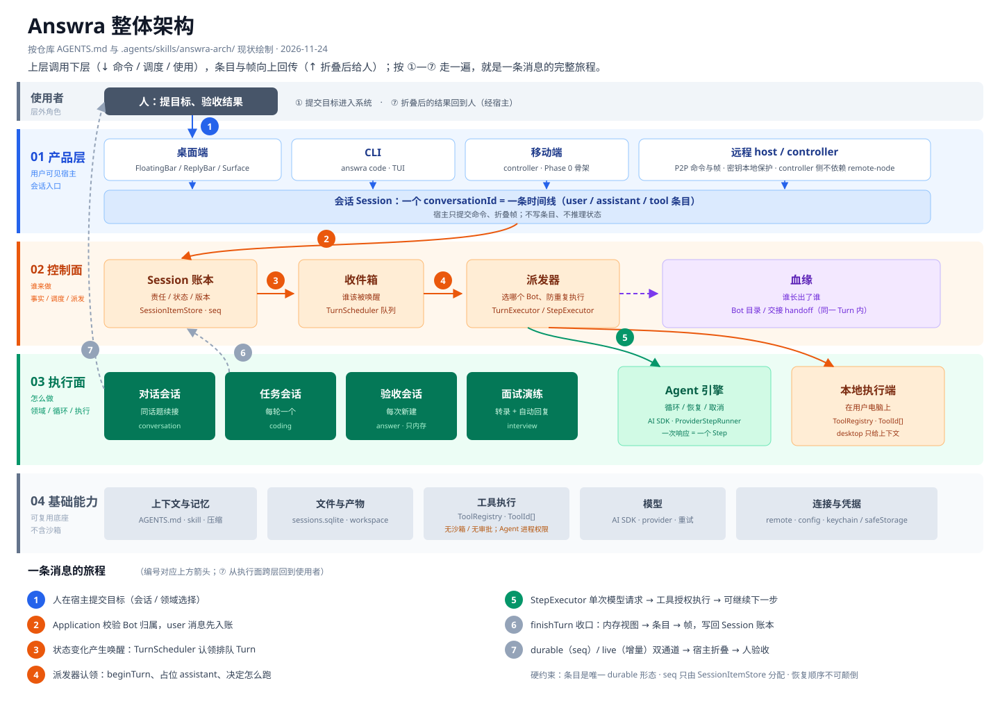

# Note：整体架构一图速览

状态：已实施

## 问题

会话架构正文已迁入 `.agents/skills/answra-arch/`，但入口仍是分层文字：向人介绍系统时，缺少一张能同时看清「四层职责 + 一条消息旅程」的总图。此前没有图，讲解只能靠逐文件翻主题页。

## 涉及范围

- 新增：`docs/notes/implemented/architecture/2026-11-24-architecture-at-a-glance.svg`（唯一图源）
- 参照：`.agents/skills/answra-arch/topology.md`、`events.md`、`state.md`、`bots.md`、`tools.md`
- 相关 Note：[会话架构文档迁入 skill 分层目录](../process/2026-11-23-architecture-skill-layout.md)

## 决定

（`2026-11-24-architecture-at-a-glance.preview.html` 是浏览器全页预览壳，只为方便查看与截图，不是第二份图源。）

- 用一张矢量 SVG（非位图）画总图：文字可直接搜索与复制，代码符号原样保留，缩放不糊。
- 图按「使用者（层外）+ 四层」组织，层间关系显式画出：上层调用下层（命令 / 调度 / 使用），条目与帧向上回传。
  - 使用者：人（提目标、验收），是层外角色，不塞进产品层；① 从人进入宿主，⑦ 跨层回到人。
  - 01 产品层：实际宿主（桌面端 / CLI / 移动端 / 远程 host 与 controller）+ 会话 Session。`conversationId` 是一条时间线，承载 user / assistant / tool 条目；仓库没有跨项目 Channel 实体，`Channel` 只是 IPC 频道常量的命名，故图中不出现「Channel」。
  - 02 协作控制面：Session 账本、TurnScheduler 收件箱、TurnExecutor/StepExecutor 派发器、Bot 目录与交接血缘。
  - 03 执行面：conversation / coding / answer / interview 四个领域 + Agent 引擎 + 本地工具执行端。
  - 04 基础能力：上下文与记忆、文件与产物、工具执行、模型、连接与凭据。工具执行只做 `ToolRegistry` 声明式授权与 `executeToolCall`，**无沙箱、无审批**；Electron renderer 的 `sandbox: true` 是渲染进程隔离，不等于命令沙箱，不得据此画成沙箱能力。
- ①—⑦ 编号对应一条消息的完整旅程：提交 → 入账 → 唤醒 → 认领 → Step 与工具 → 收口写回 → 双通道折叠与验收。图中箭头与图例编号一致。
- 图中概念与代码符号一一对应；示例图里的「Quest 账本 / 派发器 / 血缘」只是版式参考，本仓库没有 Quest 跨项目实体，因此分别映射到 Session 账本、Turn/Step 执行器与 Bot 目录/handoff，不引入新概念。
- 明确不做：不在图里塞帧字段表、schema 数量、完整 Bot 清单；这些留在 skill 主题页，图只做导航入口。

## 模块边界

- 图是 `.agents/skills/answra-arch/` 的可视化索引，不是第二份架构正文；主题页改了符号或职责，必须同笔改图。
- 只描述现状（含 mobile Phase 0、answer 只内存、renderer 尚未提供 Bot 选择入口等边界），不画未落地能力。

## 曾考虑的替代方案

- **照搬示例图的「人/宿主 + 会话 Channel + 沙箱与工具」：** 舍弃。仓库里人是层外使用者，宿主是产品层本身；`Channel` 只是 IPC 频道常量前缀，不是产品实体；工具没有沙箱或审批，把 Electron renderer 的 `sandbox: true` 当成执行沙箱会误导读者。首版曾误画，本版按代码事实改回。
- **AI 生成位图：** 中文架构标签与代码符号在生成图里会糊、会写错，且不可搜索/不可 diff，舍弃。
- **Mermaid：** 适合顺序图/依赖图，但四层泳道 + 编号回环 + 密集中文标签的排版控制力不够，舍弃；需要精确控制布局时用 SVG。
- **只写文字目录：** 讲解成本高，且无法一眼看到层间箭头，舍弃。

## 验收标准

- 可观察结果：SVG 可在浏览器与 Markdown 预览中打开，中文与代码符号清晰；四层与 ①—⑦ 编号皆可辨。
- 自动化验证：`pnpm notes:check` 通过（本 Note 为图源配套留痕）。
- 需要的实机验证：在桌面浏览器打开 SVG 截图核对一次排版；后续若有缩放/换行问题以 `viewBox` 调整，不改文案宽度。

## 后果与防回退

- 后续新增领域、通道或存储时，必须同时更新对应 skill 主题页与本图，防止图与代码漂移。
- 若未来改为文档站生成，优先直接嵌入本 SVG，不重画第二份。

## 验证

- 2026-11-24：在浏览器打开 `2026-11-24-architecture-at-a-glance.svg` 并截图核对，四层、箭头与编号图例均可见。
- 内容锚点逐条对照 `topology.md`、`events.md`、`state.md`、`bots.md`、`tools.md`，未引入仓库中不存在的实体。
